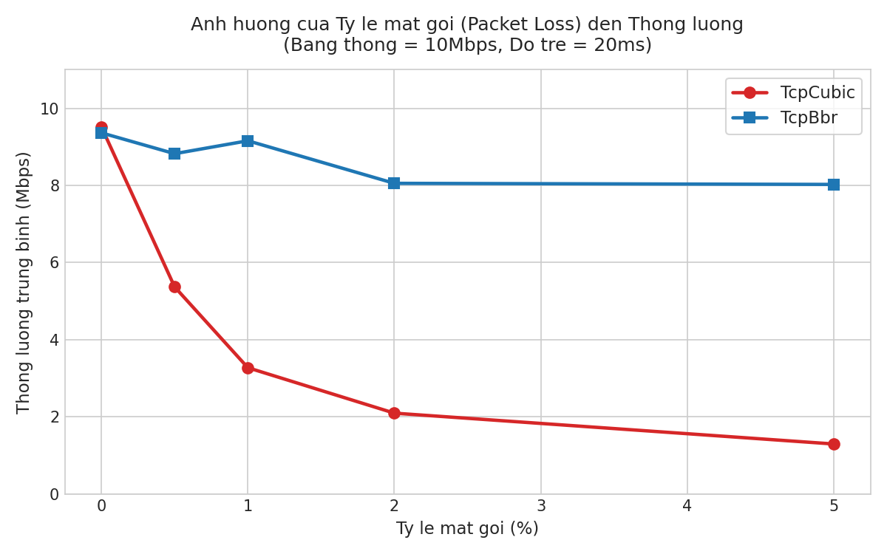
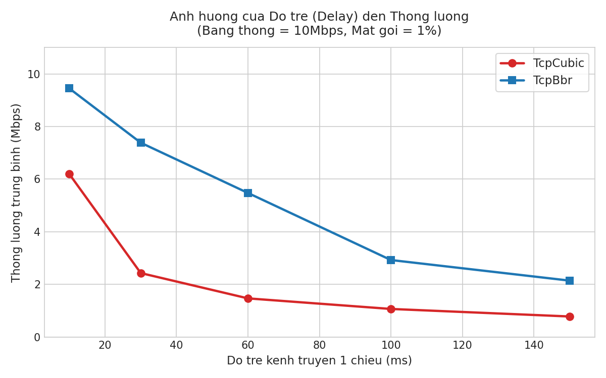
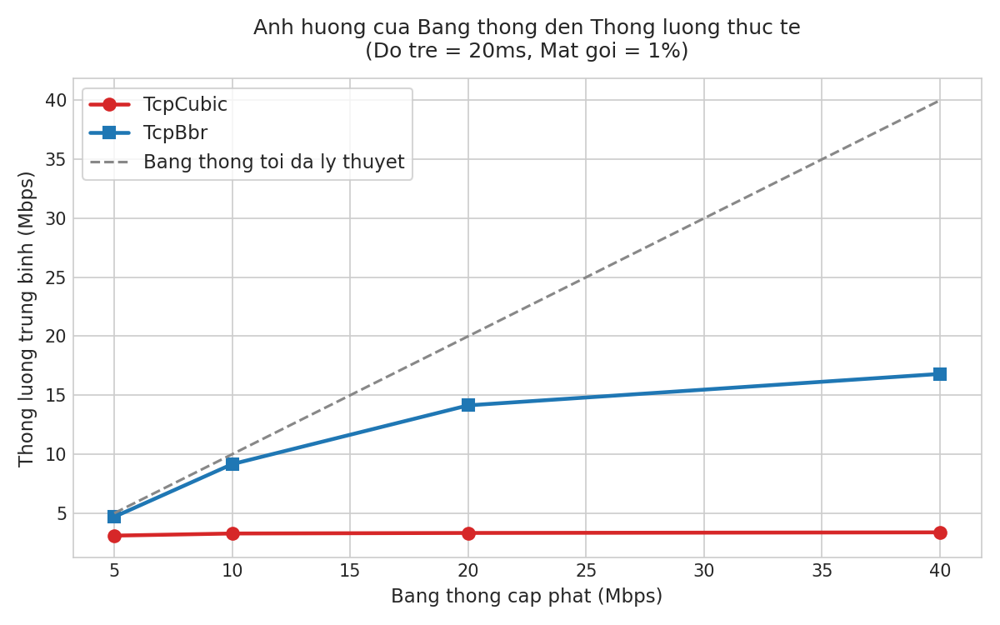
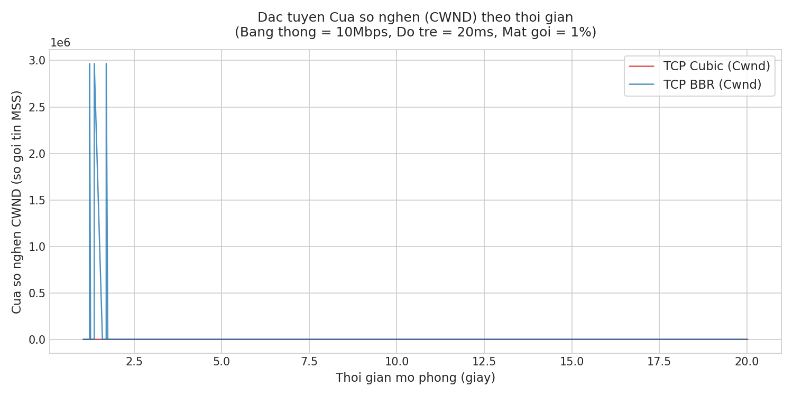
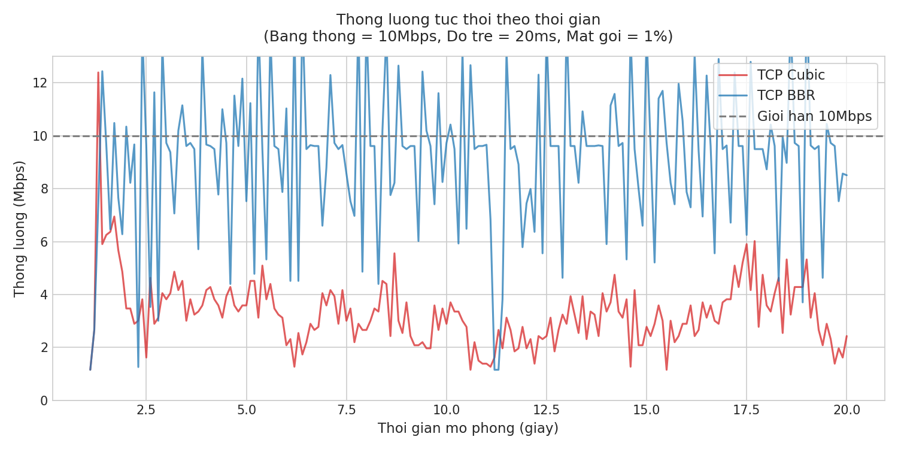
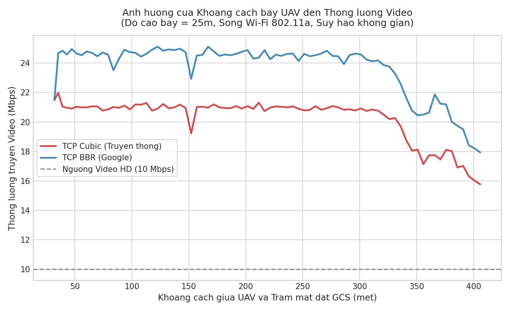

# Nghiên Cứu & Đánh Giá Hiệu Năng Các Biến Thể TCP (Cubic vs BBR) Khi Truyền Tín Hiệu Cho UAV Trên Mô Phỏng NS-3

> **Ứng dụng khảo sát bài toán truyền tin và truyền Video cho thiết bị bay không người lái (UAV / Drone)**  
> **Công cụ mô phỏng:** Network Simulator 3 (ns-3.49) trên nền tảng Ubuntu Linux / WSL 2  
> **Ngôn ngữ:** C++20 (ns-3 Core), Python 3 (Tự động hóa & Khai phá dữ liệu với Matplotlib, Pandas)

---

## 📌 1. Giới thiệu Đề tài & Đặt vấn đề

Trong các hệ thống thiết bị bay không người lái (**UAV / Drone**), kết nối mạng giữa **Trạm điều khiển mặt đất (GCS)** và **Drone** đóng vai trò huyết mạch để truyền lệnh điều khiển (*Telemetry*) và truyền luồng hình ảnh/video độ phân giải cao (*Payload Camera Stream*).

Tuy nhiên, kênh truyền vô tuyến không dây (Wi-Fi, 4G/5G) của UAV trong thực tế có đặc tính khắc nghiệt:
1. **Tỷ lệ mất gói (Packet Loss) cao:** Do nhiễu sóng vô tuyến và suy hao tín hiệu khi UAV bay ra xa.
2. **Độ trễ (RTT) biến thiên:** Phụ thuộc vào cự ly bay và môi trường địa hình.
3. **Băng thông kênh truyền thay đổi liên tục.**

### Cơ chế so sánh: TCP Cubic vs TCP BBR
* **TCP Cubic (Thuật toán truyền thống):** Hoạt động dựa trên sự kiện mất gói (*Loss-based*). Mỗi khi phát hiện rớt gói tin, Cubic lập tức coi đó là dấu hiệu mạng bị nghẽn và **cắt giảm mạnh cửa sổ nghẽn ($CWND$)**. Điều này khiến luồng truyền bị sụt giảm thông lượng nghiêm trọng trên mạng không dây.
* **TCP BBR (Bottleneck Bandwidth and RTT - do Google phát triển):** Hoạt động dựa trên mô hình ước lượng băng thông cổ chai tối đa ($BtlBw$) và thời gian trễ vòng nhỏ nhất ($RTprop$). BBR **không giảm tốc độ khi gặp mất gói ngẫu nhiên**, giúp duy trì tốc độ truyền cao và tối ưu độ trễ hàng đợi (*chống Bufferbloat*).

---

## 🏗️ 2. Cấu trúc Thư mục Dự án

```text
├── tcp-comparison.cc           # Mã nguồn C++ kịch bản 1: Khảo sát lý thuyết (Băng thông, Độ trễ, Mất gói)
├── uav-wifi-tcp.cc             # Mã nguồn C++ kịch bản 2: Mô phỏng Drone bay thực tế (Wi-Fi 802.11 + Mobility)
├── run_experiments.py         # Script Python tự động quét 30 kịch bản mạng và vẽ đồ thị
├── run_uav_experiments.py     # Script Python mô phỏng hành trình bay UAV và vẽ đồ thị cự ly
│
├── ket_qua_do_an/              # Thư mục hình ảnh & số liệu kịch bản lý thuyết
│   ├── 1_anh_huong_mat_goi.png
│   ├── 2_anh_huong_do_tre.png
│   ├── 3_anh_huong_bang_thong.png
│   ├── 4_dactuyen_cwnd_theothoidiem.png
│   ├── 5_dactuyen_throughput_theothoidiem.png
│   └── bang_tong_hop_ket_qua.csv
│
└── ket_qua_uav/                # Thư mục hình ảnh & số liệu kịch bản UAV bay
    ├── 1_uav_khoangcach_vs_thongluong.png
    ├── 2_uav_dactuyen_cwnd.png
    ├── uav_TcpCubic_metrics.csv
    └── uav_TcpBbr_metrics.csv
```

---

## 📊 3. Kết quả & Phân tích Thực nghiệm

### Phần 1: Khảo sát Lý thuyết Đa yếu tố (`tcp-comparison.cc`)

#### 1.1. Ảnh hưởng của Tỷ lệ mất gói (Packet Loss Rate)
*(Cố định: Băng thông = 10 Mbps, Độ trễ = 20 ms)*

| Tỷ lệ mất gói (%) | TCP Cubic (Mbps) | TCP BBR (Mbps) | Chênh lệch hiệu năng |
| :---: | :---: | :---: | :--- |
| **0.0% (Lý tưởng)** | 9.52 | 9.36 | Tương đương |
| **0.5%** | 5.37 | **8.82** | BBR cao hơn **1.6 lần** |
| **1.0%** | 3.27 | **9.16** | BBR vượt trội gần **3 lần** |
| **2.0%** | 2.10 | **8.05** | BBR vượt trội gần **4 lần** |
| **5.0% (Mất gói nặng)** | 1.30 | **8.03** | BBR vượt trội hơn **6.1 lần** |


> **Nhận xét:** Khi tỷ lệ mất gói tăng từ 0% lên 5%, TCP Cubic sụt giảm tới **86% thông lượng**, trong khi TCP BBR vẫn duy trì ổn định ở mức $> 8\text{ Mbps}$ (chỉ giảm khoảng 14%).

---

#### 1.2. Ảnh hưởng của Độ trễ (Delay / RTT)
*(Cố định: Băng thông = 10 Mbps, Tỷ lệ mất gói = 1%)*

| Độ trễ 1 chiều (ms) | RTT (ms) | TCP Cubic (Mbps) | TCP BBR (Mbps) | Ưu thế BBR |
| :---: | :---: | :---: | :---: | :---: |
| **10 ms** | 20 ms | 6.20 | **9.45** | +52% |
| **30 ms** | 60 ms | 2.43 | **7.38** | +203% |
| **60 ms** | 120 ms | 1.47 | **5.48** | +272% |
| **100 ms** | 200 ms | 1.07 | **2.93** | +174% |
| **150 ms** | 300 ms | 0.78 | **2.15** | +175% |


> **Nhận xét:** RTT càng lớn, thời gian chờ ACK phục hồi của Cubic càng lâu khiến thông lượng chạm đáy ($< 1\text{ Mbps}$). BBR luôn duy trì khả năng bơm gói ổn định vượt trội ở mọi mức trễ.

---

#### 1.3. Khả năng mở rộng theo Băng thông (Bandwidth Scaling)
*(Cố định: Độ trễ = 20 ms, Tỷ lệ mất gói = 1%)*

| Băng thông cấp phát | TCP Cubic (Mbps) | TCP BBR (Mbps) | Khả năng tận dụng đường truyền |
| :---: | :---: | :---: | :--- |
| **5 Mbps** | 3.09 | **4.69** | BBR tận dụng 94% đường truyền |
| **10 Mbps** | 3.27 | **9.16** | Cubic bắt đầu bị nghẽn trần |
| **20 Mbps** | 3.32 | **14.14** | **Cubic kẹt cứng ở 3.3 Mbps!** |
| **40 Mbps** | 3.37 | **16.81** | BBR mở rộng thông lượng theo băng thông |


> **Kết luận then chốt:** Khi có mất gói ngẫu nhiên 1%, dù có cấp thêm bao nhiêu băng thông (từ 10Mbps lên 40Mbps), **TCP Cubic hoàn toàn không thể tận dụng được** do liên tục bị bóp nghẽn. BBR tự động mở rộng và khai thác tối đa băng thông sẵn có.

---

#### 1.4. Động học Cửa sổ nghẽn ($CWND$) & Thông lượng tức thời

| Đặc tuyến Cửa sổ nghẽn CWND | Đặc tuyến Thông lượng tức thời |
| :---: | :---: |
|  |  |

---

### Phần 2: Kịch bản Mô phỏng Thực tế Drone bay (`uav-wifi-tcp.cc`)

* **Mô hình không gian:** Trạm GCS đặt cố định tại $(0, 0, 0)$. Drone (UAV) cất cánh ở độ cao $25\text{m}$, bay thẳng ra xa với vận tốc $10\text{ m/s}$ ($36\text{ km/h}$) trong $40\text{s}$, cự ly di chuyển từ **$25\text{m} \rightarrow 410\text{m}$**.
* **Kênh vô tuyến:** Chuẩn Wi-Fi vô tuyến IEEE 802.11a (5GHz OFDM), mô hình suy hao Log-distance Path Loss ($Exponent = 2.2$).
* **Nhiệm vụ:** UAV truyền liên tục luồng Video HD về trạm điều khiển mặt đất.

| Chỉ số đo đạc | TCP Cubic | TCP BBR | Ý nghĩa thực tế |
| :--- | :---: | :---: | :--- |
| **Tổng dung lượng Video nhận được** | $99.0\text{ MB}$ | **$115.5\text{ MB}$** | BBR truyền được thêm **16.5 MB** video |
| **Thông lượng trung bình** | $20.31\text{ Mbps}$ | **$23.70\text{ Mbps}$** | Luồng hình ảnh BBR mượt hơn |
| **Tại cự ly xa ($> 350\text{m}$)** | Tụt dốc còn $15.7\text{ Mbps}$ | Giữ vững **$18 - 21\text{ Mbps}$** | BBR chống giật/đứng khung hình khi bay xa |
| **Kích thước $CWND$ kiểm soát** | Bơm phồng lên $92$ gói | Tối ưu chặt chẽ $\approx 10$ gói | **BBR triệt tiêu hiện tượng trễ đọng hàng đợi (Bufferbloat)** |



---

## 🎯 4. Kết Luận (Conclusions)

1. **TCP Cubic không phù hợp cho mạng UAV:** Cơ chế *Loss-based* của Cubic nhầm lẫn giữa *suy hao vô tuyến/nhiễu sóng* với *nghẽn mạng*, dẫn đến việc tự bóp nghẽn lưu lượng, gây giật lag và mất kết nối camera. Đồng thời việc bơm phồng hàng đợi ($CWND = 92$) gây trễ điều khiển nghiêm trọng.
2. **TCP BBR là lựa chọn tối ưu cho UAV:** Nhờ điều khiển luồng dựa trên $BtlBw$ và $RTprop$, BBR miễn nhiễm với tỷ lệ mất gói ngẫu nhiên lên tới 5%, duy trì thông lượng ổn định ở cự ly xa và kiểm soát độ trễ hàng đợi cực thấp.

---

## 🚀 5. Hướng dẫn Chạy Lại Mô Phỏng (How to Reproduce)

### Yêu cầu hệ thống:
* Hệ điều hành: Linux (Ubuntu 22.04 LTS / WSL 2 trên Windows)
* Môi trường: NS-3 (phiên bản ns-3.36 trở lên, khuyến nghị ns-3.49)
* Thư viện Python: `pip install pandas matplotlib`

### Các bước thực hiện:
```bash
# 1. Chép 2 file kịch bản C++ vào thư mục scratch của NS-3
cp tcp-comparison.cc ~/ns3-workspace/ns-3.49/scratch/
cp uav-wifi-tcp.cc ~/ns3-workspace/ns-3.49/scratch/

# 2. Biên dịch kịch bản
cd ~/ns3-workspace/ns-3.49
./ns3 build

# 3. Chạy tự động toàn bộ khảo sát lý thuyết và xuất biểu đồ
python3 run_experiments.py

# 4. Chạy mô phỏng Drone bay và xuất biểu đồ cự ly
python3 run_uav_experiments.py
```
